# Arquitetura

## Visão geral

- **Next.js App Router**: Server Components leem dados com o cliente Supabase da sessão do usuário; mutações em Server Actions (`actions.ts` por módulo) e Route Handlers (PDF, CSV, download).
- **Supabase**: toda autorização efetiva está no banco — RLS em todas as tabelas `public`, e transições de situação apenas por RPCs `SECURITY DEFINER` com `search_path` vazio. A UI esconder um botão nunca é o controle.
- **Camada de dados** em `src/lib/data/*` (experimentos, painel, relatórios, exportações, portal, listas de apoio).
- **PDF** gerado no servidor com `@react-pdf/renderer` (sem Chromium; compatível com Vercel).
- **Multiorganização**: toda entidade tem `organization_id`; FKs compostas `(id, organization_id)` impedem apontar registros entre organizações.

## Decisões

| Tema | Decisão | Motivo |
|---|---|---|
| Colunas protegidas | Gatilhos `guard_*` rejeitam alterações de situação/autoria feitas por clientes da API (`current_user in ('authenticated','anon')`) | Menos verboso que GRANT por coluna e cobre INSERT (cliente não cria registro já aprovado) |
| Snapshot | `submit_for_review` grava `editorial_versions.content` (JSONB imutável + SHA-256); decisões, liberações, PDFs e portal usam só o snapshot | Nada é publicado a partir de dados internos mais recentes |
| Invalidação | Editar rascunho/seções/fontes após envio volta o item a `rascunho` e cancela solicitações | Aprovação vale para uma versão exata |
| Código EA360-001 | Contador por organização com `INSERT … ON CONFLICT DO UPDATE` no gatilho | Transacional; nunca reutiliza códigos |
| Booleanos de autorização | Sempre `coalesce(..., false)` | `IF NOT NULL` não dispara exceção em PL/pgSQL (bug encontrado e coberto por teste) |
| Políticas de SELECT | Usam colunas da linha, não nova busca por id | No `INSERT … RETURNING` a linha não é visível à função |
| Rich text | Blocos de texto puro (parágrafo, subtítulo, citação, lista) em JSON | Sem HTML → sem XSS; editor estruturado equivalente ao TipTap |
| Gráficos | Barras CSS + tabela acessível equivalente | Leve, acessível; apenas gráficos administrativos |
| Datas | `timestamptz` (UTC) e `date`; exibição em America/Bahia | Requisito |
| Portal | Lê apenas `public_publications` (snapshot sem fontes internas) e só quando `portal_publico_ativo` | Material público controlado por configuração e autorização |

## Modelo de dados (ER resumido)

```mermaid
erDiagram
  organizations ||--|| project_settings : configura
  organizations ||--o{ memberships : tem
  profiles ||--o{ memberships : participa
  organizations ||--o{ invitations : emite
  organizations ||--o{ institutional_authorizations : registra
  organizations ||--o{ farms : possui
  farms ||--o{ farm_areas : divide
  organizations ||--o{ people : cadastra
  people ||--o| people_contacts : "contato restrito"
  organizations ||--o{ experiments : acompanha
  people ||--o{ experiments : "pesquisador principal"
  farms ||--o{ experiments : sedia
  experiments ||--o{ experiment_members : "acesso por experimento"
  experiments ||--o{ experiment_treatments : descreve
  experiments ||--o{ experiment_milestones : planeja
  visit_schedules ||--o{ visit_schedule_experiments : inclui
  experiments ||--o{ visit_schedule_experiments : visitado
  visit_schedules ||--o{ visit_participants : participa
  visit_schedule_experiments ||--o| visit_records : "ficha única"
  visit_records ||--o{ visit_checklist_items : roteiro
  experiments ||--o{ result_summaries : "resultados recebidos"
  experiments ||--o{ files : arquivos
  files ||--o| files : "versão anterior"
  organizations ||--o{ tasks : atividades
  tasks ||--o{ task_comments : comenta
  tasks ||--o{ task_checklist_items : checklist
  visit_records ||--o{ tasks : "pendência gera"
  editorial_items ||--o{ editorial_sources : fontes
  editorial_items ||--o{ editorial_versions : "snapshots imutáveis"
  editorial_versions ||--o{ approval_requests : "fila"
  editorial_versions ||--o{ approval_decisions : "decisão assinada"
  editorial_versions ||--o{ release_permissions : "liberação por canal"
  editorial_items ||--o| bulletin_editions : boletim
  bulletin_editions ||--o{ bulletin_sections : seções
  editorial_items ||--o| dossiers : dossiê
  dossiers ||--o{ dossier_experiments : seleção
  editorial_versions ||--o{ generated_documents : "PDF + sha256"
  editorial_versions ||--o{ publication_records : publicação
  publication_records ||--o| public_publications : "snapshot público"
  publication_records ||--o{ instagram_metrics : "métricas manuais"
  organizations ||--o{ audience_feedback : feedback
  organizations ||--o{ audience_questions : dúvidas
  organizations ||--o{ pilot_milestones : "meses 1-6"
  people ||--o{ work_fronts : rodízio
  organizations ||--o{ import_batches : importações
  organizations ||--o{ activity_log : auditoria
  organizations ||--o{ notifications : avisos
```

`experimental_measurements` não foi implementada: o módulo de resultados guarda sínteses descritivas e anexos (planilhas originais preservadas na Biblioteca), conforme a regra “implementar apenas se fizer parte da tela”.

## Migrations

1. `core` — tipos, organizações, perfis, participação, convites, configurações, funções de autorização
2. `experiments` — fazendas, áreas, pessoas, experimentos, código, membros, tratamentos, marcos
3. `operations` — visitas, fichas, resultados, arquivos, tarefas, rotinas, notificações
4. `editorial` — itens, fontes, versões, aprovações, liberações, boletins, dossiês, documentos, publicações, portal, piloto, auditoria
5. `rls` — políticas deny-by-default
6. `rpc` — fluxos (convite, snapshot, decisões, validação externa, publicação, revogação, fichas, resultados, rotinas, importação, feedback)
7. `storage` — bucket privado e políticas
8. `initial_config` — espaço Entomo Agro 360 (sem pesquisas, sem contas)
9. `preview_and_audit` — pré-visualização e download auditável
10. `visit_record_fk` — vínculo direto ficha → visita
11. `security_fixes` — correções de NULL e de políticas de SELECT (cobertas por testes)
